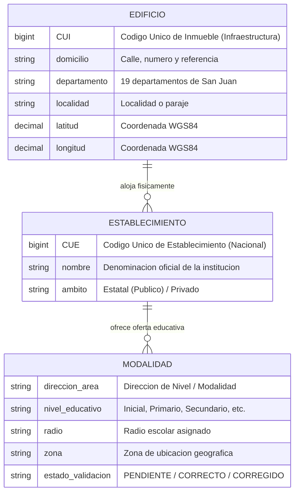
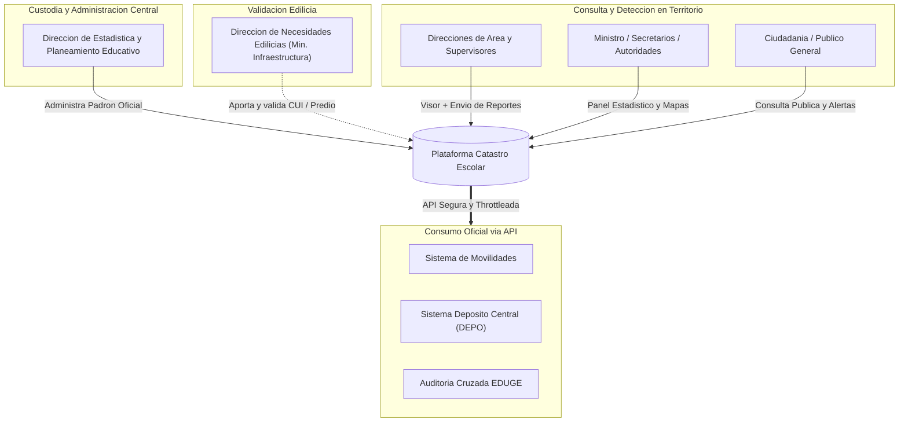
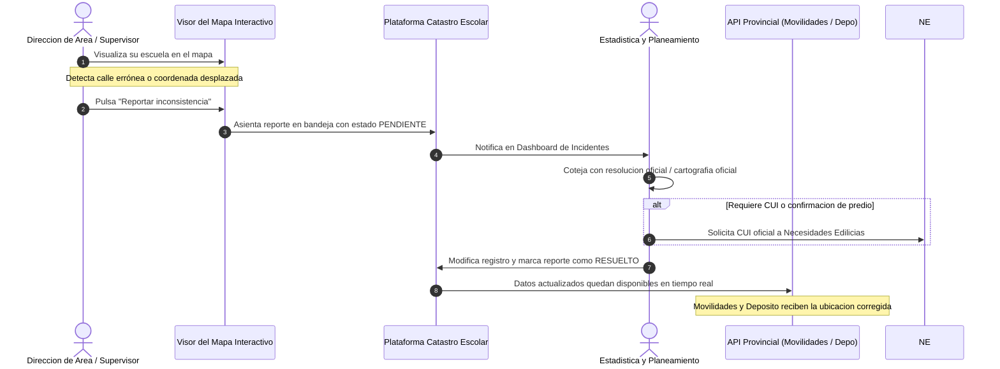

# GOBIERNO DE SAN JUAN
**Ministerio de Educación • Secretaría de Educación / Secretaría Administrativa**  
**Dirección de Sistemas e Informática**

---

# PROPUESTA DE IMPLEMENTACIÓN Y MARCO DE GOBERNANZA
## Plataforma de Catastro Geo-Administrativo Escolar y Mapa Interactivo Provincial

> **Código:** PROP-CATASTRO-EDU-2026-V1  
> **Alcance:** Ministerio de Educación (Estadísticas, Planeamiento, Direcciones de Área), Ministerio de Infraestructura (Necesidades Edilicias) y Plataformas Consumidoras (Movilidades, Depósito Central, EDUGE)  
> **Emisión:** Octubre 2026  
> **Estado:** PROPUESTA OFICIAL / EN EVALUACIÓN  

---

## 1. Resumen Ejecutivo

La Dirección de Sistemas e Informática del Ministerio de Educación pone a disposición la plataforma de **Catastro Geo-Administrativo Escolar**, una solución tecnológica centralizada, moderna y segura (desarrollada sobre Laravel 12, React 18, Inertia.js y Leaflet) concebida para:

1. **Constituir la Fuente Única de la Verdad (*Single Source of Truth*):** Identificar con precisión matemática dónde está cada escuela, cómo se llama, qué códigos oficiales posee y qué ámbito territorial cubre.
2. **Visualización y Toma de Decisiones:** Dotar a las autoridades ministeriales y a las Direcciones de Área de un **Mapa Interactivo Provincial** y un **Panel de Control Analítico (Dashboard)** con métricas en tiempo real.
3. **Calidad y Saneamiento de Datos:** Auditar, depurar y conciliar la base de datos local contra padrones oficiales (eliminando inconsistencias y duplicaciones), con capacidad técnica preparada para una futura auditoría cruzada con la plataforma **EDUGE** sujeta a la decisión de las autoridades ministeriales.
4. **Interoperabilidad Interministerial (API Oficial):** Servir datos geográficos y administrativos certificados a sistemas operativos críticos del Gobierno Provincial: **Gestión de Movilidades Escolares**, **Depósito Central de Suministros (DEPO)** y futuras integraciones de transporte e infraestructura.

---

## 2. Alcance y Delimitación de los Datos

Para garantizar la estabilidad, escalabilidad y exactitud de la información, el sistema modela estrictamente la realidad física y organizativa de la provincia mediante tres entidades normalizadas:

### ✅ Datos Comprendidos (Núcleo Oficial):
- **Identificadores Oficiales:** CUE (Establecimiento) y CUI (Inmueble).
- **Georreferenciación Precisa:** Coordenadas GPS (Latitud/Longitud validadas) y georreferenciación sexagesimal (DMS).
- **Localización Administrativa:** Departamento, localidad, código postal, calle, número y referencias de acceso.
- **Estructura Administrativa:** Ámbito (Público / Privado), Dirección de Área dependiente, Nivel educativo/modalidad, Zona y Radio escolar.
- **Trazabilidad de Calidad:** Bitácora de validación de cada registro, indicando agente, fecha y observaciones.

### ⛔ Límites del Sistema (No incluidos en esta etapa):
- **Alumnos y Matrícula:** La matrícula nominal y asistencia corresponden a la plataforma de gestión académica (**EDUGE**).
- **Turnos y Divisiones:** Los horarios internos de cursado no forman parte del catastro físico-administrativo.
- **Planta Docente / RRHH:** Liquidaciones y cargos corresponden a los sistemas de personal del Ministerio.

---

## 3. Modelo de Gobernanza y Matriz de Roles (RBAC)

La integridad de los datos requiere definir con claridad **quién crea, quién valida y quién consulta**, evitando que registros duplicados o coordenadas erróneas degraden la calidad del servicio.

### 3.1. Matriz de Responsabilidades por Área

| Área / Actor | Rol en el Sistema | Acciones Habilitadas | Restricciones Operativas |
| :--- | :--- | :--- | :--- |
| **Estadística y Planeamiento** | **Custodio del Dato / Administrador Operativo** | • Alta, baja y modificación de Edificios, Establecimientos y Modalidades. • Asignación y verificación de CUEs oficiales. • Resolución de reportes e inconsistencias emitidos desde el mapa. • Control de calidad de padrones oficiales y ReNaP. • Aprobación de estados de validación (`CORRECTO` / `CORREGIDO`). • Conducción de auditorías cruzadas futuras con EDUGE (si las autoridades lo disponen). | Responsable primario ante el Ministerio de la calidad de la base. |
| **Necesidades Edilicias** *(Min. Infraestructura)* | **Validador Edilicio / Colaborador Inmueble** | • Consulta de fichas de edificios. • Carga, rectificación y validación de **CUI** (Código Único de Inmueble). • Validación de límites de predio y coordenadas de entrada. | **Sin acceso** a modificar CUEs, nombres de escuelas ni ofertas educativas. |
| **Direcciones de Área** *(Inicial, Primaria, Secundaria, Técnica, Privada, etc.)* | **Autoridades de Nivel (Visor + Reportante)** | • Consulta y filtrado de su padrón de escuelas en el Mapa Interactivo. • Exploración del Panel de Control (Dashboard) con métricas de su área. • Exportación de listados oficiales en PDF y Excel. • Emisión de **Reportes de Inconsistencia** ante cambios en territorio. | **No pueden crear ni editar registros directamente**, previniendo duplicación de edificios compartidos. |
| **Supervisores Escolares** | **Agente Territorial (Reportante)** | • Verificación visual in situ de las escuelas bajo su zona. • Envío de reportes geográficos (ej. acceso modificado, radio erróneo). | Solo lectura y reporte. |
| **Dirección de Sistemas e Informática** | **Administrador Técnico (Sysadmin)** | • Mantenimiento de infraestructura de servidores y base de datos. • Gestión de usuarios, roles y seguridad RBAC. • Monitoreo, control de tasa (*throttling*) y entrega de tokens para la API. • Copias de seguridad automáticas y auditoría de accesos. | No altera datos sustantivos de las escuelas sin solicitud formal de Planeamiento. |

---

## 4. Circuito de Calidad: Sistema de Reportes e Incidencias

Para mantener la base de datos permanentemente saneada sin burocracia en papel, la plataforma incorpora un circuito digital de **Reportes Georreferenciados**:

---

## 5. Integración con Otras Plataformas e Interoperabilidad (API)

El Catastro Escolar no es un sistema aislado; es la **infraestructura base** que nutre a los demás proyectos del Gobierno:

### 5.1. Sistema de Movilidades Escolares
- **Necesidad:** Diagramar recorridos de transporte escolar, combis y traslados de alumnos de zonas rurales o alejadas.
- **Aporte del Catastro:** Provee coordenadas de latitud/longitud exactas de la puerta de ingreso de cada edificio, departamento y radio de cobertura, evitando cálculos erróneos de distancias y optimizando el gasto en combustible.

### 5.2. Sistema de Gestión de Depósito Central (DEPO)
- **Necesidad:** Enviar partidas de insumos pedagógicos, copa de leche, mobiliario y kits escolares a los establecimientos.
- **Aporte del Catastro:** Vincula cada entrega al CUI/CUE oficial con dirección normalizada, garantizando que los transportistas descarguen en el predio correcto y no en sedes administrativas temporales.

### 5.3. Auditoría Cruzada con EDUGE *(Propuesta para Futura Implementación)*
- **Situación Actual (Cotejo Manual / "A Ojo"):** Actualmente, la validación se realiza mediante inspección visual operador por operador a través del módulo de auditoría de la plataforma (`/administrativos/auditoria`), cotejando manualmente pantalla contra pantalla si una escuela figura activa en EDUGE y registrando el cambio de estado con observaciones a mano. Es un procedimiento funcional pero artesanal y dependiente de la carga humana.
- **Evolución Propuesta (Automatización Algorítmica vía API):** Dotar al sistema de un conector directo o servicio web seguro (API REST) que cruce en segundos las bases de datos de forma desatendida. El algoritmo compararía los padrones automáticamente e informaría únicamente las discrepancias reales:
  - CUEs activos en EDUGE que no cuenten con georreferenciación en el catastro.
  - Edificios con oferta en el catastro que figuren dados de baja o inexistentes en EDUGE.
  - Diferencias en denominaciones oficiales o departamentos.
- **Criterio de Aplicación:** Este módulo se deja planteado como una **funcionalidad optativa y modular**. Quedará a exclusiva consideración y decisión de las autoridades ministeriales y de la Dirección de Planeamiento determinar la oportunidad y necesidad de activar dicha integración o auditoría conjunta.

---

## 6. Seguridad, Trazabilidad y Arquitectura Técnica

El sistema ha sido construido bajo las más estrictas normas de seguridad gubernamental:
- **Control de Acceso Basado en Roles (RBAC):** Middleware de seguridad que impide a usuarios no autorizados acceder a funciones administrativas o de edición.
- **Auditoría Completa (*Audit Trail*):** Cada modificación en los datos de una escuela, cambio de coordenadas o resolución de reporte registra automáticamente la fecha, hora, dirección IP y usuario responsable.
- **Protección de Datos:** Cifrado de contraseñas con algoritmos modernos (bcrypt), protección nativa contra inyecciones SQL y ataques CSRF, y limitador de velocidad (*rate limiting*) en endpoints públicos y APIs.
- **Disponibilidad y Rendimiento:** Base de datos relacional optimizada con indexación multifiltro, garantizando respuestas en milisegundos en el mapa interactivo y dashboard.

---

## 7. Próximos Pasos Recomendados para la Implementación

1. **Aprobación de la Propuesta:** Validación por parte de las autoridades de la Secretaría de Educación y Secretaría Administrativa y Financiera.
2. **Designación de Referentes Operativos:**
   - Designar 2 agentes clave de **Estadística y Planeamiento** para la administración del padrón.
   - Designar 1 referente técnico de **Necesidades Edilicias** para la mesa de enlace del CUI.
3. **Jornada de Inducción Técnica:** Dictado de un taller práctico por parte de Sistemas para el uso de la consola administrativa, resolución de reportes y exportación de métricas.
4. **Activación de Credenciales de API:** Emisión de tokens de acceso seguros para las plataformas de Movilidades y Depósito Central.
5. **Campaña de Difusión a Direcciones de Área:** Presentación del visor de mapa y capacitación breve sobre cómo emitir reportes de corrección territorial.

---

*Documento técnico elaborado por la Dirección de Sistemas e Informática • Ministerio de Educación de San Juan.*
